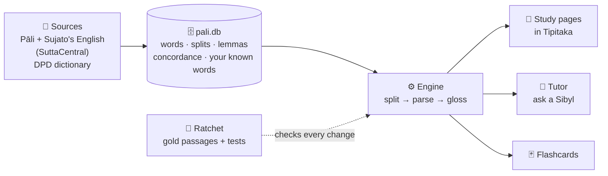

📚 [Directory ↗](obsidian://open?vault=Directory&file=Directory) › Pali NLP

![[Pali NLP Banner.svg]]

# ☸️ Pali NLP — learning to read the Buddha's own words

**What this is:** a project to help Roy **learn Pāli and read the Tipiṭaka closely**. It splits the sound-merged words (sandhi), names every word's dictionary form and grammar, lays Bhante Sujato's English beside each Pāli line, finds every other place a word occurs, and tutors on demand, always with citations and never from guesswork.

**This vault is where you understand and track the project.** The reading itself happens in the **[Tipitaka vault](obsidian://open?vault=Tipitaka&file=Tipitaka)**. The code lives in the public **[pali-nlp repository](https://github.com/roydsouza/pali-nlp)**.

> [!summary] 📍 Where it stands — 2026-10-29
> **Phase 0 · Setting up.** Proposal reviewed by the Coven and approved by Roy with revisions; this vault created; Nemesis is drafting the design. Next: the **sandhi pilot** on MN 10, MN 118 and SN 56.11.
> → **[[Status]]** for the full checklist · **[[Progress Log]]** for what happened when

---

## 🧭 Start here
| Page | What it tells you |
|---|---|
| 🎯 **[[How It Will Work]]** | what you'll be able to do, in plain words: the reading page, the tutor, the flashcards |
| 🏗️ **[[Design]]** | how it's built: sources, the database, the engine, the surfaces |
| ✅ **[[Status]]** | the checklist, phase by phase; nothing is ticked until it's verified |
| ⚖️ **[[Decisions]]** | every decision, dated, with who made it and why |
| 📓 **[[Progress Log]]** | a dated diary of the work |
| 📖 **[[How to Use]]** | the user guide, once there is something to use |
| ℹ️ **[[About This Vault]]** | who looks after it, and how it relates to the other vaults |

---

## 🗺️ The system at a glance

## 👥 Who does what
| Who | Role |
|---|---|
| **Roy** | decides scope; judges whether it actually helps; approves each phase |
| **Nemesis** | builds it: design, engine, database, pilot |
| **Galena** | coordinates; keeps DPD current; reports status from [[Status]] |
| **Minerva** | checks sources, grammar claims and licences |
| **Lilith** | attacks the parser: odd Unicode, adversarial sandhi, wrong output |
| **Serenity** | banners, diagrams, the README and the user guide |
| **Athena** | surveys existing Pāli tools so we don't rebuild them |
