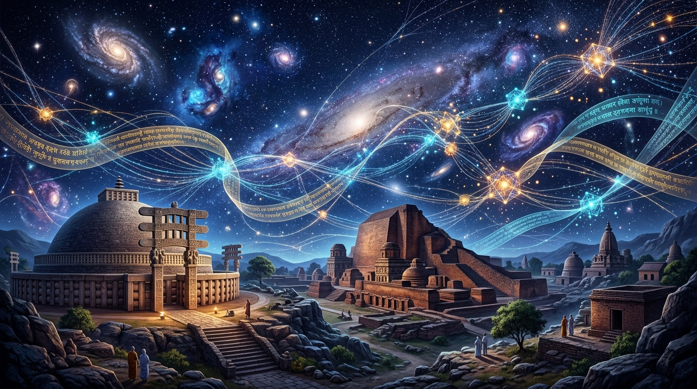
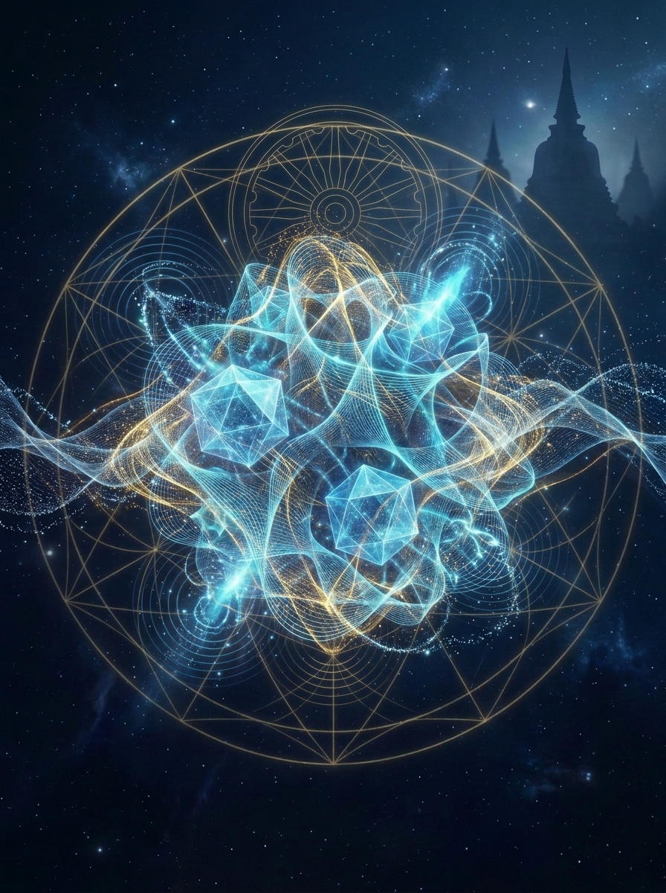
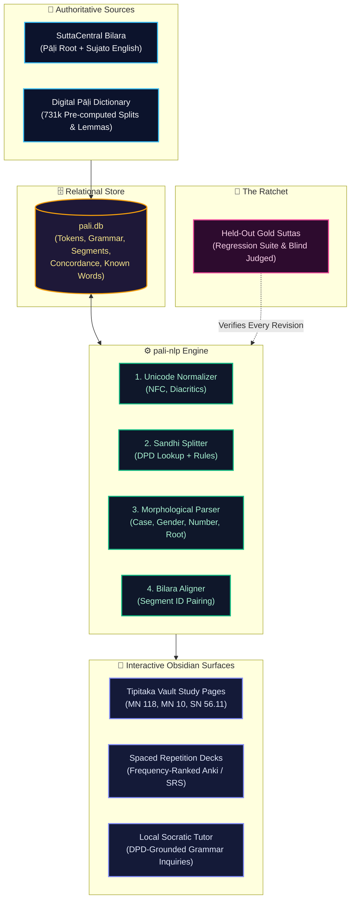

<p align="center">
  
</p>

# ☸️ Pāli NLP: Learning to Read the Buddha's Own Words
### Computational Linguistics, Subatomic Kalāpas & Interlinear Scaffolding for the Tipiṭaka

<p align="center">
  <a href="https://github.com/roydsouza/pali-nlp-vault/stargazers"></a>
  <a href="https://github.com/roydsouza/pali-nlp-vault/network/members"></a>
  <a href="https://github.com/roydsouza/pali-nlp-vault/blob/main/LICENSE"></a>
  <a href="https://github.com/roydsouza/pali-nlp"></a>
  <a href="https://digitalpalidictionary.github.io/"></a>
</p>

---

## 🌌 The Vision: Ancient Dhamma at the Quantum Horizon

Over two and a half millennia ago along the banks of the Ganges, the Buddha articulated a radical phenomenology of existence: all composite physical reality is composed of instantaneous, dynamic, vibrating subatomic units termed **rūpa-kalāpas** (*literally: "clusters of form"*). In the Theravāda Abhidhamma, these kalāpas arise and pass away billions of times per twinkling of an eye—prefiguring the harmonic filaments of modern **quantum string theory** and the vibrating manifold geometry of the multiverse.

**Pāli NLP** is an open research vault and computational linguistic workbench designed to dissolve the phonological and grammatical barriers between the modern reader and the original canonical Pāḷi text. Grounded in the **Digital Pāḷi Dictionary (DPD)** and Bhikkhu Sujato's open English translations (*bilara-data* from SuttaCentral), this system builds an **adaptive learning ladder**:
1. **Sandhi Splitting**: Deterministically unravelling phonological mergers (`tathāgatopi → tathāgato + api`).
2. **Morphological Parsing**: Grammatical case, number, tense, root, and compound analysis for every lemma.
3. **Thinning Wheels**: Interlinear glossing that intelligently hides words you already know, letting scaffolding fall away as your direct comprehension deepens.
4. **Local Corpus RAG & Tutor**: Morphology-aware contextual querying grounded in canonical references without cloud hallucination.

---

<p align="center">
  
  <br/>
  <em>"Rūpa-kalāpa as Resonating Quantum Strings" — Subatomic form arising and passing away within the Dhammacakka lattice.</em>
</p>

---

## 🏛️ System Architecture

The pipeline processes the Canonical Pāḷi corpus through a deterministic-first linguistic engine backed by local SQLite storage (`pali.db`), keeping bulk data fast and offline while generating elegant Obsidian study companions on demand.



---

## 🔬 Sandhi Deconstruction in Action

In ancient Pāḷi manuscripts, adjacent words fuse phonologically across boundaries (*sandhi*), creating compound tokens that obscure meaning for learners. **Pali NLP** resolves these compounds into their constituent grammatical elements:

<p align="center">
  
</p>

### Example: MN 118 (Ānāpānasati Sutta)
```text
Canonical Form:   tathāgatopi
Sandhi Split:     tathāgato + api
Morphology:       [tathāgata] masc nom sg  +  [api] indecl particle
Interlinear:      "the Realized One"       +  "even, also"
Synthesis:        "Even the Realized One"
```

---

## 🗂️ Vault Structure & Exploration

This repository represents the official knowledge base and tracking dashboard for the project:

```
pali-nlp-vault/
├── assets/
│   ├── hero-cosmic-kalapa.jpg         # Panoramic cosmic Nalanda & string-theory mural
│   ├── kalapa-strings-multiverse.jpg  # Metaphysical Rūpa-kalāpa quantum geometry
│   └── Pali NLP Banner.svg            # Interactive SVG dashboard banner
├── Pali NLP.md                        # Central obsidian dashboard & status overview
├── How It Will Work.md                # End-user experience, reader mode, tutor
├── Design.md                          # Technical architecture, SQLite schema, pipeline
├── Decisions.md                       # Architectural decision log with rationales
├── Status.md                          # Phase-by-phase verification checklist
├── Progress Log.md                    # Detailed chronologically-dated session log
├── About This Vault.md                # Maintenance roles, boundaries, and governance
└── How to Use.md                      # Operational guide for study page generation
```

---

## 🧭 Foundational Study Suttas (Phase 0 Pilot)

Rather than generating thousands of unread files into an iCloud vault, study pages are generated **on demand** for specific suttas in Roy's daily contemplative practice:

| Sutta | Name | Core Subject | Focus |
|---|---|---|---|
| **[MN 118](https://suttacentral.net/mn118)** | *Ānāpānasati Sutta* | Mindfulness of Breathing | The 16 steps, 4 tetrads, 7 awakening factors |
| **[MN 10](https://suttacentral.net/mn10)** | *Satipaṭṭhāna Sutta* | The Four Foundations of Mindfulness | Direct body contemplation, feeling, mind, dhammas |
| **[SN 56.11](https://suttacentral.net/sn56.11)** | *Dhammacakkappavattana Sutta* | Setting in Motion the Dhamma Wheel | The Four Noble Truths & Noble Eightfold Path |

---

## 📜 Acknowledgements & Data Governance

- **Texts & Translations**: Root Pāḷi text and English translations by Bhikkhu Sujato courtesy of [SuttaCentral](https://suttacentral.net/) under [Creative Commons Zero (CC0)](https://creativecommons.org/publicdomain/zero/1.0/).
- **Lexical Data**: [Digital Pāḷi Dictionary (DPD)](https://digitalpalidictionary.github.io/) created by Ven. Bodhirasa and contributors, used under [Creative Commons Attribution-NonCommercial-ShareAlike 4.0 International (CC BY-NC-SA 4.0)](https://creativecommons.org/licenses/by-nc-sa/4.0/).
- **Companion Engine**: The Python processing pipeline code lives at [roydsouza/pali-nlp](https://github.com/roydsouza/pali-nlp).

---

<p align="center">
  <em>"Sabba-pāpassa akaraṇaṁ, kusalassa upasampadā,<br/>
  Sacitta-pariyodapanaṁ, etaṁ buddhāna-sāsanaṁ."</em><br/>
  <strong>— Dhammapada 183</strong>
</p>
